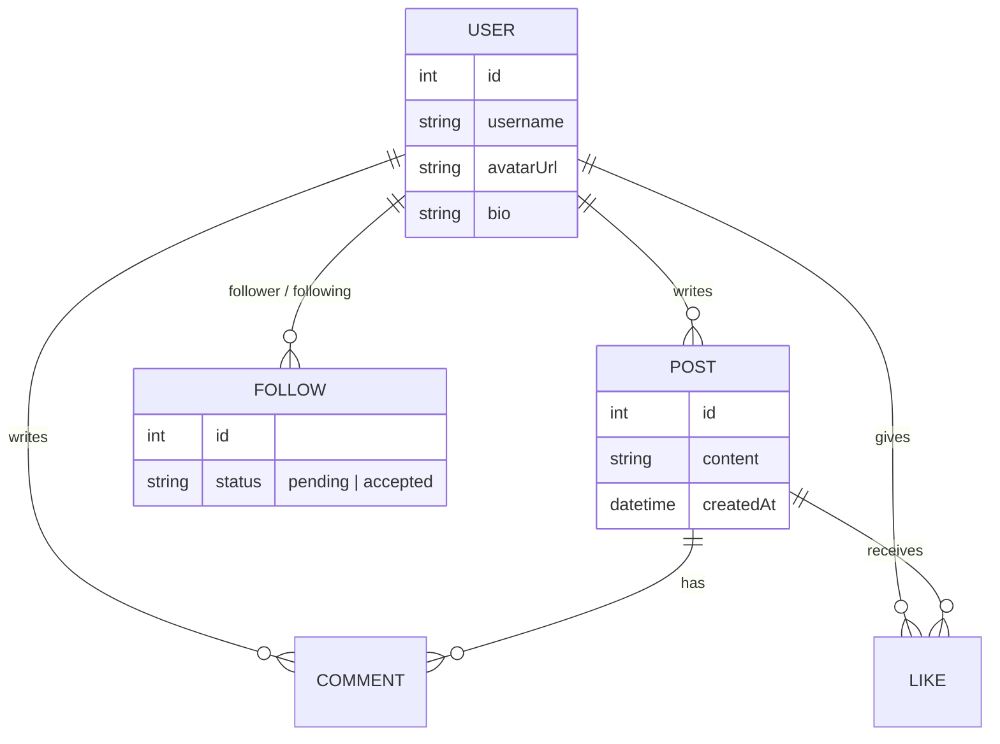

# Odin-Book — <!-- your app name -->

A social media clone built as the final project of [The Odin Project's Node.js path](https://www.theodinproject.com/lessons/node-path-nodejs-odin-book). Users can sign in, follow each other, post, like and comment.

**Live demo:** <!-- link -->
**Guest login:** <!-- one-click guest sign-in button, or credentials -->
**Inspired by:** <!-- Facebook / X / Threads / Myspace / other -->

<!-- Add a screenshot or GIF here -->
<!--  -->

---

## Why I built this

<!-- 2-3 sentences: what you wanted to learn, and why this project matters to you. -->

## Features

### Core (required)

- [ ] Authentication required for everything except the sign-in page
- [ ] Sign in with <!-- passport-local / passport-github2 / other -->
- [ ] Send, accept and decline follow requests
- [ ] Create text posts
- [ ] Like posts
- [ ] Comment on posts
- [ ] Posts always show content, author, comments and likes
- [ ] Feed page showing recent posts from me and people I follow
- [ ] Profile with picture (<!-- Gravatar / GitHub avatar / upload -->)
- [ ] Profile page showing info, photo and posts
- [ ] Users index with follow buttons (hidden if already following or pending)
- [ ] Deployed

### Extra credit

- [ ] Image posts (<!-- URL / Cloudinary / Supabase Storage -->)
- [ ] Update profile photo
- [ ] Guest sign-in
- [ ] Styling polish

### My own additions

<!-- Anything beyond the brief: real-time updates, notifications, chat, infinite scroll, dark mode, etc. -->

-
-

## Tech stack

| Layer | Choice | Why |
| --- | --- | --- |
| Frontend | React, <!-- Vite? --> | <!-- --> |
| Routing | <!-- React Router --> | <!-- --> |
| Styling | <!-- CSS Modules / Tailwind / styled-components --> | <!-- --> |
| Backend | Node.js, Express | <!-- --> |
| Database | PostgreSQL | <!-- --> |
| ORM | Prisma | <!-- --> |
| Auth | Passport.js (<!-- strategy -->), <!-- sessions / JWT --> | <!-- --> |
| Seeding | `@faker-js/faker` | Populate fake users and posts |
| Image hosting | <!-- Cloudinary / Supabase / none --> | <!-- --> |
| Hosting | <!-- Render / Railway / Fly.io / Vercel --> | <!-- --> |

## Planning

### Scope

**Must have (do first):** <!-- list -->

**Nice to have (only after core is done):** <!-- list -->

**Out of scope:** <!-- list -->

### Data model

<!-- Sketch your schema before coding. Paste an ERD image or a Mermaid diagram. -->



**Decisions to make and record:**

- How do I model follows and pending requests? <!-- answer -->
- How do I stop a user liking the same post twice? <!-- answer -->
- What happens to comments and likes when a post is deleted? <!-- answer -->

### API routes

| Method | Route | Description | Auth |
| --- | --- | --- | --- |
| POST | `/auth/<!-- -->` | <!-- sign in --> | No |
| GET | `/posts` | <!-- feed --> | Yes |
| POST | `/posts` | <!-- create --> | Yes |
| POST | `/posts/:id/like` | <!-- toggle like --> | Yes |
| POST | `/posts/:id/comments` | <!-- add comment --> | Yes |
| GET | `/users` | <!-- list users --> | Yes |
| GET | `/users/:id` | <!-- profile --> | Yes |
| POST | `/users/:id/follow` | <!-- send request --> | Yes |
| <!-- --> | <!-- --> | <!-- --> | <!-- --> |

## Getting started

### Prerequisites

- Node.js <!-- version -->
- PostgreSQL <!-- version -->
- <!-- anything else -->

### Installation

```bash
# 1. Clone
git clone <!-- repo url -->
cd <!-- folder -->

# 2. Backend
cd server
npm install
cp .env.example .env     # then fill in the values below
npx prisma migrate dev
npm run seed             # optional: fake users and posts
npm run dev

# 3. Frontend (new terminal)
cd client
npm install
cp .env.example .env
npm run dev
```

### Environment variables

**Server (`server/.env`)**

```
DATABASE_URL=
SESSION_SECRET=          # or JWT_SECRET=
CLIENT_URL=
# GITHUB_CLIENT_ID=
# GITHUB_CLIENT_SECRET=
# CLOUDINARY_URL=
```

**Client (`client/.env`)**

```
VITE_API_URL=
```

## Project structure

```
<!-- Paste your tree here once it settles -->
/client
/server
```

## What I learned

- **Auth:** <!-- -->
- **Relational modelling (many-to-many, self-relations):** <!-- -->
- **Prisma:** <!-- -->
- **React state and data fetching:** <!-- -->
- **Deployment:** <!-- -->

## Challenges and how I solved them

1. **Problem:** <!-- -->
   **Fix:** <!-- -->
2. **Problem:** <!-- -->
   **Fix:** <!-- -->

## Known issues and future improvements

- <!-- -->
- <!-- -->

## Time spent

<!-- Rough hours: planning / backend / frontend / deployment -->

## Resources

- [Odin-Book project brief](https://www.theodinproject.com/lessons/node-path-nodejs-odin-book)
- [Passport.js docs](https://www.passportjs.org/)
- [Prisma docs](https://www.prisma.io/docs)
- [Faker](https://github.com/faker-js/faker)
- <!-- tutorials, articles, anything that helped -->

## Licence

<!-- MIT? -->